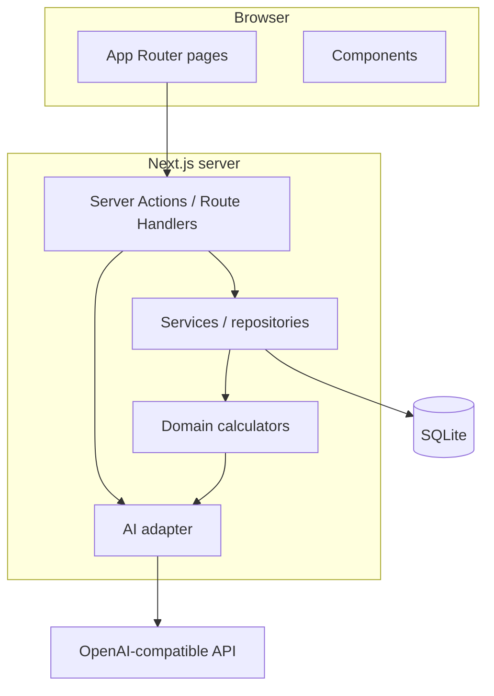

# Architecture

Ledgerly is a **local Next.js application** with **server-side data access** to SQLite. The browser renders UI; business logic runs on the server in TypeScript modules.

## Layer diagram



## Directory layout (target)

Created incrementally by slices; full tree after slice 09:

```
ledgerly/
  data/                    # gitignored DB
  drizzle/
  docs/
  src/
    app/                   # routes per ux.md
    components/            # UI primitives
    db/
      schema.ts
      client.ts
      repositories/        # CRUD per aggregate
    domain/                # pure functions + tests
      net-worth.ts
      emergency-fund.ts
      goals.ts
      personality.ts
      allocation.ts
      findings.ts
      financial-snapshot.ts
    ai/
      client.ts
      tasks/
      prompts/
    lib/
      money.ts             # format cents for display
      dates.ts
  tests/ or src/domain/**/*.test.ts
```

## Request flow (typical)

1. User submits form on a page.
2. Server Action validates with Zod (or similar).
3. Repository writes to SQLite.
4. Action returns updated DTO for revalidation or redirects.
5. Read pages call repository + domain calculators; no LLM on critical path except optional enrich steps.

## Domain vs services

| Layer | Responsibility |
|-------|----------------|
| `domain/*` | Pure functions: inputs in, results out. Unit tested. |
| `repositories/*` | SQL via Drizzle; map rows to types. |
| `services/*` | Orchestrate repo reads + domain for a use case (e.g. "dashboard summary"). |
| `ai/*` | Build task input from snapshot; call model; validate JSON schema; cache in `ai_results`. |

**Rule:** Money arithmetic only in `domain/` or `lib/money.ts`, never in prompt text generation without passing precomputed numbers in JSON.

## Financial snapshot (for AI and debugging)

Built by `buildFinancialSnapshot(asOfDate)` in `domain/financial-snapshot.ts`. Read-only aggregate; no PII beyond what user typed (names optional—strip or shorten in AI input if user enables privacy setting later; v1 include asset names).

### TypeScript shape (canonical)

```typescript
type FinancialSnapshot = {
  version: string; // e.g. "2026-01-01"
  asOf: string; // date
  currency: string;
  netWorth: {
    totalAssetsCents: number;
    totalLiabilitiesCents: number;
    netWorthCents: number;
    byAssetType: Record<string, number>;
  };
  cashflow: {
    trailingMonths: 3;
    incomeCents: number;
    expenseCents: number;
    surplusCents: number;
    savingsRate: number | null;
    essentialMonthlyAverageCents: number;
    discretionaryShareOfExpenses: number | null;
    uncategorizedExpenseShare: number | null;
  };
  emergencyFund: {
    targetMonths: number;
    targetCents: number;
    eligibleCents: number;
    fundedRatio: number | null;
    gapCents: number;
    avgMonthlySurplusCents: number | null;
    monthsToCloseGap: number | null;
  };
  goals: Array<{
    id: number;
    name: string;
    bucket: "short" | "mid" | "long";
    targetAmountCents: number;
    targetDate: string;
    setAsideCents: number;
    remainingCents: number;
    requiredMonthlyCents: number;
    status: "on_track" | "tight" | "shortfall";
    plannedMonthlyCents: number | null;
  }>;
  investorProfile: {
    label: string;
    title: string;
    riskScore: number;
    horizonScore: number;
    experienceScore: number;
    liquidityScore: number;
  } | null;
  allocation: {
    targetBand: { cash: number; bonds: number; equities: number; other: number };
    currentMix: { cash: number; bonds: number; equities: number; other: number };
    shortGoalRemainingCents: number;
  };
  findings: Array<{
    id: string;
    severity: "info" | "warn";
    data: Record<string, number | string | boolean | null>;
  }>;
  categories: Array<{ id: number; name: string; kind: "expense" | "income"; isEssential: boolean }>;
};
```

Snapshot is hashed (canonical JSON sort keys) for `ai_results.input_hash`.

## AI integration

- Env: `AI_API_KEY`, optional `AI_BASE_URL`, `AI_MODEL`.
- If key missing: skip LLM; use template strings from finding id + data.
- Client: POST chat/completions with `response_format: json_schema` (or tool call) per [ai-contracts.md](ai-contracts.md).
- Log prompt version constant per task in `src/ai/prompts/*/version.ts`.

## Security (v1)

- Dev server localhost only.
- No auth: anyone on the machine can access—acceptable for personal local use.
- Do not send API keys to client bundle.
- Sanitize user notes before LLM (length cap 500 chars).

## Performance

- SQLite on single user is sufficient.
- Snapshot build may run on each dashboard/briefing load; cache in memory per request.
- Index dates on expenses/incomes.

## Testing strategy

| Area | Approach |
|------|----------|
| Domain | Vitest unit tests with fixed fixtures |
| Repositories | Optional integration tests with temp DB file |
| AI | Mock client; golden JSON schema validation |
| E2E | Out of scope until post-v1 |

## Slice alignment

| Slice | Architecture touchpoints |
|-------|---------------------------|
| 01 | `db/`, settings repo, app shell |
| 02 | assets, liabilities, snapshots, net-worth domain |
| 03–04 | journal repos, categories |
| 05–06 | emergency + goals domain on services |
| 07 | personality domain + profile repo |
| 08 | findings domain |
| 09 | `ai/`, snapshot builder, cache table |

## Related

- [data-model.md](data-model.md)
- [ai-contracts.md](ai-contracts.md)
- [ux.md](ux.md)
