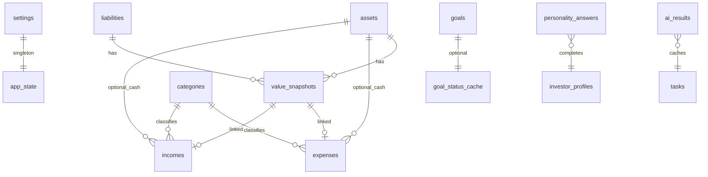

# Data model (SQLite + Drizzle)

Physical database: `data/ledgerly.db` (gitignored). All `amount*` fields are **integer cents**. Timestamps ISO 8601 UTC unless noted.

## Entity relationship (overview)

---

## Table: `settings`

Single row `id = 1`.

| Column | Type | Notes |
|--------|------|-------|
| id | integer PK | always 1 |
| display_currency | text | default `EUR` |
| emergency_fund_target_months | integer | default 6 |
| essential_monthly_spend_override_cents | integer nullable | |
| personality_revealed_at | text nullable | ISO datetime |
| created_at | text | |
| updated_at | text | |

---

## Table: `assets`

| Column | Type | Notes |
|--------|------|-------|
| id | integer PK | |
| type | text | enum from product.md |
| name | text | |
| is_liquid | integer | 0/1 |
| include_in_allocation | integer | 0/1, default 1. New real estate, vehicles, receivables, and businesses default to 0 in the form. |
| cash_pct | integer | Sleeve weight 0–100. With bonds/equities/other must sum to 100. |
| bonds_pct | integer | |
| equities_pct | integer | |
| other_pct | integer | Default 100 for new rows before form defaults apply. |
| notes | text nullable | |
| created_at | text | |
| updated_at | text | |

Index: `(type)`.

---

## Table: `liabilities`

| Column | Type | Notes |
|--------|------|-------|
| id | integer PK | |
| type | text | enum |
| name | text | |
| notes | text nullable | |
| created_at | text | |
| updated_at | text | |

---

## Table: `value_snapshots`

| Column | Type | Notes |
|--------|------|-------|
| id | integer PK | |
| asset_id | integer nullable FK → assets.id | exactly one of asset_id / liability_id set |
| liability_id | integer nullable FK → liabilities.id | |
| recorded_on | text | date |
| amount_cents | integer | ≥ 0 |
| note | text nullable | |
| created_at | text | |

Indexes: `(asset_id, recorded_on)`, `(liability_id, recorded_on)`.

Constraint (app-level): XOR asset_id / liability_id.

---

## Table: `categories`

| Column | Type | Notes |
|--------|------|-------|
| id | integer PK | |
| name | text | unique per kind |
| kind | text | `expense` \| `income` |
| is_essential | integer | 0/1, expense only |
| sort_order | integer | default 0 |
| created_at | text | |

Seed defaults on first run (slice 03): see slice file.

---

## Table: `expenses`

| Column | Type | Notes |
|--------|------|-------|
| id | integer PK | |
| amount_cents | integer | > 0 |
| occurred_on | text | date |
| category_id | integer nullable FK | |
| asset_id | integer nullable FK → assets.id | cash assets only; `on delete set null` |
| linked_snapshot_id | integer nullable FK → value_snapshots.id | snapshot from cash link; `on delete set null` |
| recurring_template_id | integer nullable FK → recurring_templates.id | set when posted from a template (slice 14); `on delete set null` |
| recurring_period | text nullable | `YYYY-MM`, `YYYY` or `YYYY-Www`; unique with `recurring_template_id` |
| import_batch_id | integer nullable FK → import_batches.id | set when imported from a statement (slice 15); `on delete set null` |
| import_fingerprint | text nullable | `date|amount|kind|normalized description|n`; used to detect re-imports |
| note | text nullable | |
| created_at | text | |
| updated_at | text | |

Index: `(occurred_on)`, `(category_id)`, `(asset_id)`, `(import_fingerprint)`; unique `(recurring_template_id, recurring_period)`.

---

## Table: `incomes`

| Column | Type | Notes |
|--------|------|-------|
| id | integer PK | |
| amount_cents | integer | > 0 |
| occurred_on | text | date |
| category_id | integer nullable FK | |
| asset_id | integer nullable FK → assets.id | cash assets only; `on delete set null` |
| linked_snapshot_id | integer nullable FK → value_snapshots.id | snapshot from cash link; `on delete set null` |
| recurring_template_id | integer nullable FK → recurring_templates.id | set when posted from a template (slice 14); `on delete set null` |
| recurring_period | text nullable | `YYYY-MM`, `YYYY` or `YYYY-Www`; unique with `recurring_template_id` |
| import_batch_id | integer nullable FK → import_batches.id | set when imported from a statement (slice 15); `on delete set null` |
| import_fingerprint | text nullable | `date|amount|kind|normalized description|n`; used to detect re-imports |
| note | text nullable | |
| created_at | text | |
| updated_at | text | |

Index: `(occurred_on)`, `(category_id)`, `(asset_id)`, `(import_fingerprint)`; unique `(recurring_template_id, recurring_period)`.

---

## Table: `recurring_templates` (slice 14)

| Column | Type | Notes |
|--------|------|-------|
| id | integer PK | |
| kind | text | `expense` \| `income` |
| amount_cents | integer | > 0; expected amount, editable per posting |
| amount_varies | boolean | review list focuses the amount |
| match_text | text nullable | text on bank statements; import dedupe (slice 15) |
| category_id | integer nullable FK | kind must match; `on delete set null` |
| asset_id | integer nullable FK → assets.id | cash account; `on delete set null` |
| link_cash | boolean | true when `asset_id` is set |
| note | text | description shown in lists and copied to posted rows |
| cadence | text | `monthly` \| `yearly` \| `weekly` |
| anchor_on | text | first occurrence; month-end clamps |
| end_on | text nullable | |
| active | boolean | paused templates post nothing |
| created_at, updated_at | text | |

---

## Table: `import_batches` (slice 15)

| Column | Type | Notes |
|--------|------|-------|
| id | integer PK | |
| source | text | `pdf` |
| parser_id | text | `cgd-movimentos` or `activobank-extrato` |
| file_name | text | the file itself is never stored |
| file_sha256 | text | warns on re-upload of the same file |
| period_from, period_to | text nullable | statement period |
| closing_balance_cents | integer nullable | from the statement header |
| asset_id | integer nullable FK → assets.id | `on delete set null` |
| link_mode | text | `none` \| `closing` \| `per_row` |
| closing_snapshot_id | integer nullable FK → value_snapshots.id | snapshot written in `closing` mode; `on delete set null` |
| row_count | integer | |
| created_at | text | |

Undo deletes the batch's journal rows (reversing cash links newest first), its closing snapshot, restores entries listed in `import_batch_updates`, then the batch. It is refused if a linked row is frozen.

## Table: `import_batch_updates` (slice 18)

| Column | Type | Notes |
|--------|------|-------|
| id | integer PK | |
| batch_id | integer FK → import_batches.id | `on delete cascade` |
| kind | text | `expense` \| `income` |
| entry_id | integer | the recurring-posted entry this import confirmed |
| previous_amount_cents, previous_occurred_on | | values before the import |
| previous_fingerprint | text nullable | |

---

## Table: `goals`

| Column | Type | Notes |
|--------|------|-------|
| id | integer PK | |
| name | text | |
| target_amount_cents | integer | |
| target_date | text | date |
| set_aside_cents | integer | default 0 |
| planned_monthly_cents | integer nullable | user plan |
| expected_annual_return_bps | integer nullable | |
| created_at | text | |
| updated_at | text | |

Derived bucket `short|mid|long` computed in domain layer, not stored (optional cache column allowed).

---

## Table: `personality_answers`

| Column | Type | Notes |
|--------|------|-------|
| question_key | text PK | e.g. `risk_comfort` |
| option_id | text | |
| updated_at | text | |

---

## Table: `investor_profiles`

Single active row `id = 1` (replace on retake).

| Column | Type | Notes |
|--------|------|-------|
| id | integer PK | 1 |
| label | text | enum label id |
| risk_score | integer | 0–100 |
| horizon_score | integer | |
| experience_score | integer | |
| liquidity_score | integer | |
| completed_at | text | |
| created_at | text | |

---

## Table: `ai_results`

| Column | Type | Notes |
|--------|------|-------|
| id | integer PK | |
| task | text | `category_suggest` \| `tips` \| `goal_explain` \| `briefing` |
| entity_id | text nullable | e.g. expense id or goal id |
| input_hash | text | sha256 of canonical input JSON |
| prompt_version | text | |
| output_json | text | |
| created_at | text | |

Unique index: `(task, entity_id, input_hash)` for cache lookup.

---

## Migrations

- Use Drizzle Kit migrations in `drizzle/` (created in slice 01).
- Never edit applied migrations; add new ones.

---

## Deletion policy

- Hard delete OK for v1.
- Deleting asset/liability deletes its snapshots (FK cascade).
- Deleting category: set null on expenses/incomes or block if entries exist (slice 03: block delete if in use).

---

## Default seed data (slice 01/03)

**Settings:** one row with EUR, 6 months emergency target.

**Expense categories (essential flagged):**

| name | is_essential |
|------|----------------|
| Housing | yes |
| Utilities | yes |
| Groceries | yes |
| Transport | no |
| Dining | no |
| Health | yes |
| Insurance | yes |
| Entertainment | no |
| Shopping | no |
| Education | no |
| Other | no |

**Income categories:** Salary, Freelance, Investment income, Other.
