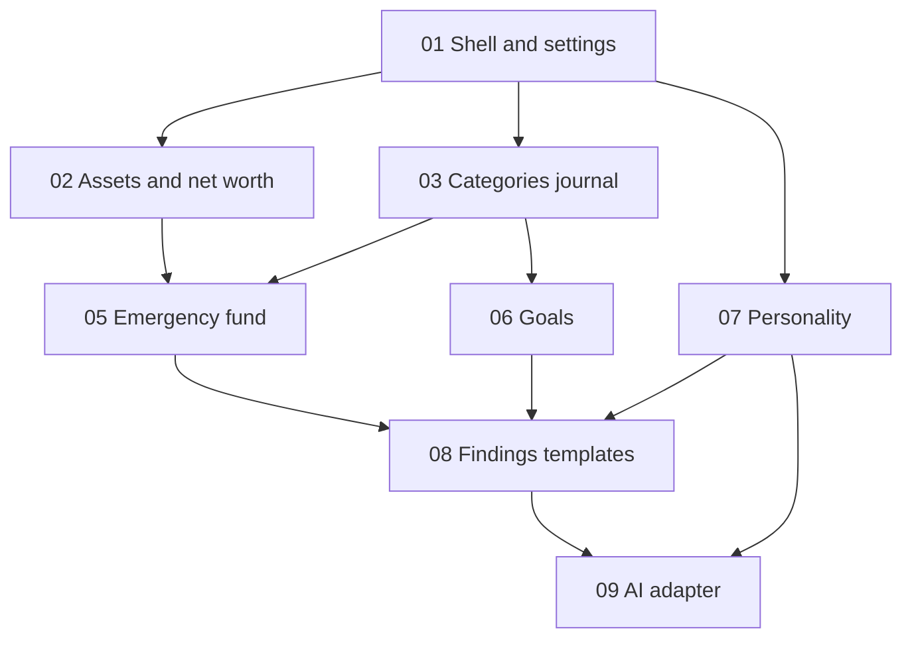

# Roadmap

Build Ledgerly **one slice per agent session** unless the user explicitly asks for more. Each slice has acceptance checks in `docs/slices/`.

## Dependency graph

## Slice index

| # | File | Delivers |
|---|------|----------|
| 01 | [slices/01-app-shell-settings.md](slices/01-app-shell-settings.md) | Next.js app, SQLite, settings page, layout nav |
| 02 | [slices/02-assets-net-worth.md](slices/02-assets-net-worth.md) | Assets, liabilities, snapshots, dashboard net worth |
| 03 | [slices/03-categories-expenses-income.md](slices/03-categories-expenses-income.md) | Categories seed, expense/income CRUD, activity tabs |
| 05 | [slices/05-emergency-fund.md](slices/05-emergency-fund.md) | Emergency fund page + domain tests |
| 06 | [slices/06-goals.md](slices/06-goals.md) | Goals CRUD + feasibility calculator tests |
| 07 | [slices/07-personality.md](slices/07-personality.md) | Quiz, reveal, stored profile |
| 08 | [slices/08-findings-templates.md](slices/08-findings-templates.md) | Findings detectors + dashboard tips templates |
| 09 | [slices/09-ai-integration.md](slices/09-ai-integration.md) | AI client + four tasks + cache |

## Optional prototype (not a slice)

If goal math or personality reveal feels wrong before coding slices 06–07, add a throwaway HTML logic demo per project prototype skill; do not merge to main until validated.

## Definition of done for v1

All slice acceptance boxes satisfied; `pnpm test` passes domain tests; `pnpm dev` runs on localhost; app usable without `AI_API_KEY`.

## After v1 (backlog ideas—do not implement without new slices)

- Bank CSV import
- Multi-currency with manual FX rates
- Auth for remote access
- Bond bucket tagging on assets
- Recurring expenses
